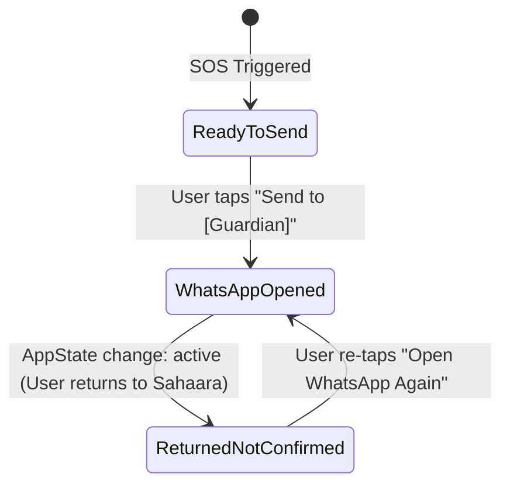

# SAHAARA: Manual WhatsApp SOS Demonstration Implementation Report

## Executive Summary

While the **Twilio WhatsApp Sandbox** correctly enforces security boundaries by blocking automated outbound SOS broadcasts (`SANDBOX_MODE_RESTRICTION`), hackathon demonstrations require an authentic, real-time emergency alert arriving on a guardian's WhatsApp phone. 

To bridge this without compromising security or misleading users, the green **"Send via WhatsApp yourself"** manual fallback in SAHAARA has been upgraded to a **multi-guardian, individual-dispatch emergency system**. It derives contacts strictly from the authenticated elder's Firestore database, generates a structured emergency payload with live GPS coordinates and Google Maps links, opens WhatsApp via deep links, and tracks honest, non-misleading lifecycle states across application switches.

All 38 test suites pass with zero regressions.

---

## 1. Architectural Changes & File Manifest

### A. [`services/sos.js`](file:///C:/Users/gkv47/Downloads/Sahaara/services/sos.js)
1. **[`buildEmergencyMessage`](file:///C:/Users/gkv47/Downloads/Sahaara/services/sos.js#L194-L246)**:
   - Formats a comprehensive emergency alert message with emojis and markdown:
     - Heading: `🚨 *SAHAARA EMERGENCY ALERT* 🚨`
     - Senior name: `*User:* <Name>`
     - Emergency reason: `*Emergency Reason:* <Reason>`
     - Foreground GPS coordinates: `*Coordinates:* <lat>, <lng> (±<acc>m)`
     - Direct Google Maps query URL: `https://www.google.com/maps/search/?api=1&query=<lat>,<lng>`
     - Formatted timestamp: `*Time:* <ISO / Locale Time>`
     - Urgent action prompt: `⚠️ *URGENT: Please call or contact <Name> immediately!*`
   - Handles fallbacks gracefully when GPS location is unavailable.
2. **[`buildGuardianWaLink`](file:///C:/Users/gkv47/Downloads/Sahaara/services/sos.js#L248-L256)**:
   - Sanitizes and normalizes recipient numbers to international format (stripping spaces, hyphens, parentheses, and leading plus sign for `wa.me`).
   - Uses `encodeURIComponent` to guarantee safe URL parameter transmission.
3. **[`buildFallbackWaLinks`](file:///C:/Users/gkv47/Downloads/Sahaara/services/sos.js#L258-L277)**:
   - Iterates through all registered Firestore emergency contacts and generates individual deep links for each guardian.
4. **[`sendSOS`](file:///C:/Users/gkv47/Downloads/Sahaara/services/sos.js#L42-L177)**:
   - Enriches the response payload with `emergencyMessage`, `fallbackGuardians`, and primary `fallbackWaLink`, ensuring the mobile client has everything ready immediately upon SOS trigger.

### B. [`components/SosModal.js`](file:///C:/Users/gkv47/Downloads/Sahaara/components/SosModal.js)
1. **Multi-Guardian Rendering**:
   - Replaced single-contact button with individual guardian action cards.
   - Displays Guardian Name, Relationship tag, and Phone Number.
   - Dedicated WhatsApp button (`#25D366`) per guardian.
2. **Honest State Machine**:
   - Tracks per-contact lifecycle state:
     - `ready`: Default initial state ("Ready to send").
     - `opened`: Set when elder taps the WhatsApp button ("WhatsApp opened").
     - `returned`: Set via React Native `AppState` change listener when the user returns to SAHAARA ("Returned • Not confirmed as sent").
   - Explicitly informs the user that WhatsApp cannot programmatically confirm whether the user pressed the send button or dismissed the app.
3. **Instructional Notice Box**:
   - Highlights that WhatsApp requires manual action:
     > *"WhatsApp will open with your emergency message prefilled. You must tap Send (✈️) in WhatsApp to deliver the message."*
4. **Responsive Layout**:
   - Encapsulated within a scrollable container (`ScrollView` with `maxHeight: '90%'`) so devices with 3+ contacts do not suffer UI clipping.

### C. [`server/test/twilio_sos.test.js`](file:///C:/Users/gkv47/Downloads/Sahaara/server/test/twilio_sos.test.js)
Added two dedicated regression tests (expanding suite from 36 to 38 tests):
- **Test 37**: Validates `buildEmergencyMessage` contains the emergency alert header, user name, reason, coordinates, Google Maps link, timestamp, and urgent call prompt.
- **Test 38**: Validates `buildGuardianWaLink` and `buildFallbackWaLinks` properly sanitize phone numbers, format `wa.me/<number>?text=...`, and preserve individual contact associations.

---

## 2. Emergency Message Structure & Formatting

The generated message adheres strictly to WhatsApp markdown:

```text
🚨 *SAHAARA EMERGENCY ALERT* 🚨

*User:* Ramesh Patel
*Emergency Reason:* Medical Emergency - Chest pain
*Location:* 28.613939, 77.209021
*Coordinates:* 28.613939, 77.209021 (±12m)
*Map Link:* https://www.google.com/maps/search/?api=1&query=28.613939,77.209021
*Time:* 11/1/2026, 4:55:00 AM

⚠️ *URGENT: Please call or contact Ramesh Patel immediately!*
```

---

## 3. UI State Lifecycle Diagram



---

## 4. Automated Test Verification

Execution command: `npm --prefix server test`
Results: **38 passed, 0 failed**.

```text
Testing: 36. REGRESSION: /api/twilio/test-connectivity requires valid Firebase token ... ✅ PASSED
Testing: 37. REGRESSION: Manual emergency message format includes all required hackathon parameters ... ✅ PASSED
Testing: 38. REGRESSION: Multi-guardian fallback builds individual wa.me links with correct URL encoding ... ✅ PASSED

================================================================
Results: 38 passed, 0 failed.
================================================================
```

---

## 5. Physical Two-Phone Hackathon Demonstration Guide

Follow this script during the live hackathon pitch to demonstrate authentic SOS delivery:

### Step 1: Pre-Demo Setup
1. **Phone A (Elder device)**: Log in to SAHAARA with an active account. Ensure at least two emergency contacts are registered in **Emergency Contacts** settings.
2. **Phone B (Guardian device)**: Set Phone B's phone number as Guardian 1 on Phone A. Ensure WhatsApp is installed on both devices.

### Step 2: Triggering the SOS Alert
1. On **Phone A**, tap the prominent red **SOS** button on the home screen.
2. Observe the automatic dispatch status:
   - System logs incident in Firestore.
   - Captures foreground GPS coordinates.
   - Shows Twilio Sandbox banner explaining automated messaging is disabled in sandbox mode.
3. Observe the **"Manual WhatsApp Fallback"** section:
   - Notice box explaining: *"WhatsApp will open with your emergency message prefilled. You must tap Send (✈️) in WhatsApp to deliver the message."*
   - Guardian 1 card shows **"Ready to send"** badge.
   - Guardian 2 card shows **"Ready to send"** badge.

### Step 3: Sending to Guardian 1
1. On **Phone A**, tap **"Send to [Guardian 1 Name] (WhatsApp)"**.
2. WhatsApp launches instantly:
   - Chat opens directly with Phone B.
   - Text box is prefilled with the emergency alert, coordinates, Google Maps link, and timestamp.
3. Tap the green **Send (✈️)** button in WhatsApp.
4. On **Phone B**: The emergency notification chimes and appears on the lock screen / chat window.

### Step 4: Returning to SAHAARA & Multi-Guardian Dispatch
1. Switch back to SAHAARA on **Phone A**.
2. Notice the UI state for Guardian 1 has automatically transitioned to **"Returned • Not confirmed as sent"** (`#D97706` amber badge).
3. The UI now offers **"Open WhatsApp Again"** for Guardian 1, while Guardian 2 remains in **"Ready to send"**.
4. Tap **"Send to [Guardian 2 Name] (WhatsApp)"** to repeat the process for Guardian 2.
5. On **Phone B**, open the Google Maps link received in WhatsApp to demonstrate real-time location resolution of the elder.
