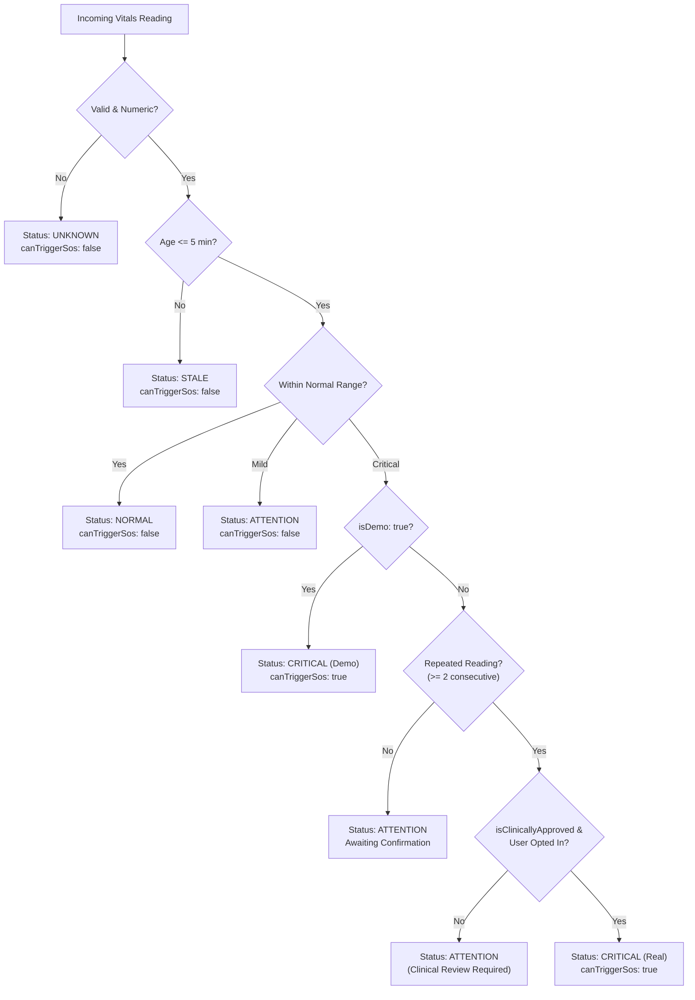

# SAHAARA: Vitals Monitoring with Automatic SOS Emergency Detection Implementation Report

## Executive Summary

The **Vitals Monitoring with Automatic SOS Emergency Detection** feature has been implemented into the SAHAARA mobile application. It connects SAHAARA to the **Android Health Connect** ecosystem to ingest health measurements from smartwatches and companions (such as Samsung Health, Google Pixel Watch / Fitbit, Garmin, and Google Fit). 

A standalone, testable **Critical Event Detection Engine** evaluates metrics against configurable safety rules, enforces a **repeated-measurement confirmation requirement** (2 consecutive readings), applies a **5-minute emergency staleness cutoff**, and triggers an **Emergency Alert Countdown Modal (10s)** before dispatching the existing authenticated SOS workflow. 

For hackathon presentation and testing without a physical smartwatch, an isolated **Hackathon Demo Simulator** enables simulating normal vitals, critical heart-rate drops/spikes (152 BPM), and critical blood oxygen drops (86% SpO2) with 100% network isolation (zero real WhatsApp messages).

All 58 test scenarios (38 Twilio SOS + 20 Vitals & Smartwatch tests) pass cleanly with zero failures.

---

## 1. Initial Repository Audit Findings

- **Mobile Architecture:** Expo React Native (Expo SDK `~54.0.37`, React Native `0.81.5`, React `19.1.0`), file-based navigation via Expo Router v6.
- **Navigation & Layout:** Senior-first "Kanjeevaram maroon" design system (`constants/theme.js`) with warm paper surfaces (`#FAF3E3`), high-contrast typography (Fraunces, Mukta, Noto Serif Devanagari), and large touch targets (>= 48px).
- **Existing SOS Workflow:** `components/SosModal.js` and `services/sos.js` communicate with Express backend `/api/sos`, capture 3-tier foreground-only GPS (`expo-location`), retrieve emergency contacts from Firestore `users/{uid}/emergencyContacts`, and log emergency incidents under `sos_alerts`.
- **Firebase Authentication:** ID token verification is authenticated via Firebase Admin SDK modular imports (`firebase-admin/app`, `firebase-admin/auth`, `firebase-admin/firestore`) and sent as `Authorization: Bearer <token>`.
- **Twilio WhatsApp Integration:** Configured in Sandbox mode (`TWILIO_WHATSAPP_MODE=sandbox`). Enforces `SANDBOX_MODE_RESTRICTION` upfront on `/api/sos`, blocks default Appointment Reminder templates (`HXfe5ab5f00277942d4d4200328b4d403c`), and provides multi-guardian manual WhatsApp deep links (`wa.me/<phone>?text=...`).

---

## 2. Health Connect Integration Approach

Rather than relying on deprecated Google Fit developer APIs, SAHAARA uses **Android Health Connect** as the centralized on-device integration layer.

```
Smartwatch (Samsung Galaxy Watch, Pixel Watch, Wear OS, Amazfit)
   │
   ▼
Watch Manufacturer Companion App (Samsung Health, Fitbit, Zepp Life)
   │
   ▼
Android Health Connect (Local Android System Datastore)
   │
   ▼
SAHAARA Health Connect Service (`services/healthConnectService.js`)
   │
   ▼
Vitals Screen (`app/vitals.js`) & Evaluation Engine (`services/vitalsEngine.js`)
   │
   ▼
Emergency Countdown Modal (`components/VitalsEmergencyModal.js`)
   │
   ▼
Existing SOS Orchestration (`services/sos.js` -> `/api/sos`)
```

- **Native Package:** `react-native-health-connect` v4.1.3 installed and configured with its official Expo config plugin in `app.json`.
- **Granular Permissions:** Requests only necessary read permissions:
  1. `android.permission.health.READ_HEART_RATE`
  2. `android.permission.health.READ_OXYGEN_SATURATION`
  3. `android.permission.health.READ_BLOOD_PRESSURE`
  4. `android.permission.health.READ_RESPIRATORY_RATE`
  5. `android.permission.health.READ_RESTING_HEART_RATE`
- **Graceful Fallbacks:** 
  - **iOS:** Detects `Platform.OS === 'ios'` and returns `UNSUPPORTED_PLATFORM`, clearly noting that Health Connect is an Android system service and Apple HealthKit integration is planned.
  - **Expo Go:** Detects standard Expo Go runtime and displays `EXPO_GO_DEV_BUILD_REQUIRED` with guidance to run a native development build (`npx expo run:android`) or use the built-in Demo Simulator.

---

## 3. Actual Vitals Available from Connected Sources

| Metric | Record Type | Availability & Hardware Dependencies |
|---|---|---|
| **Heart Rate** | `HeartRate` | Widely available across virtually all modern smartwatches and fitness trackers. Ingested as individual timestamped BPM samples. |
| **Blood Oxygen (SpO2)** | `OxygenSaturation` | Available on most modern smartwatches (Samsung Galaxy Watch 4+, Pixel Watch 1/2/3, Apple Watch Series 6+ via companion sync). Ingested as percentage (%). |
| **Blood Pressure** | `BloodPressure` | Hardware dependent. Available on Samsung Galaxy Watch (in calibrated regions) or smart BP cuffs syncing to Health Connect. If unsupported, gracefully hidden. |
| **Respiratory Rate** | `RespiratoryRate` | Typically recorded during sleep or rest sessions by Wear OS and Fitbit. Ingested as breaths/minute. |
| **Resting Heart Rate** | `RestingHeartRate` | Calculated periodically by Samsung Health and Fitbit as a daily baseline metric. |

Data sources are tracked via `metadata.dataOrigin` and translated to human-readable labels (e.g. `com.sec.android.app.shealth` $\rightarrow$ *"Samsung Health"*, `com.fitbit.FitbitMobile` $\rightarrow$ *"Fitbit (Google Pixel Watch)"*).

---

## 4. Synchronized Records vs True Real-Time Monitoring

> [!IMPORTANT]
> **Health Connect is a periodic synchronization repository, NOT a continuous real-time streaming bus.**
> - Health Connect does not support continuous sub-second background callbacks to third-party applications.
> - Watch companion apps (Samsung Health, Fitbit) write batches of measurements periodically (e.g., every 5–15 minutes, or upon user-initiated sync).
> - SAHAARA synchronizes fresh data on foreground launch, via user-initiated refresh, or when the senior returns to the application (`AppState` change).
> - **Continuous background monitoring** would require a native Wear OS application running a Foreground Service with direct PPG sensor access (`Wear OS Health Services API`). SAHAARA accurately discloses the latest measurement timestamp and never misrepresents stale records as live.

---

## 5. Files Created & Modified

### Created Files
1. [`config/vitalsRules.js`](file:///C:/Users/gkv47/Downloads/Sahaara/config/vitalsRules.js): Versioned safety configuration, clinical approval guard flag, consecutive reading requirements, and non-authoritative reference ranges.
2. [`services/vitalsEngine.js`](file:///C:/Users/gkv47/Downloads/Sahaara/services/vitalsEngine.js): Standalone evaluation engine returning `NORMAL`, `ATTENTION`, `CRITICAL`, `UNKNOWN`, `STALE`.
3. [`services/healthConnectService.js`](file:///C:/Users/gkv47/Downloads/Sahaara/services/healthConnectService.js): Android Health Connect abstraction layer with permission rationales and fallback handling.
4. [`components/VitalsEmergencyModal.js`](file:///C:/Users/gkv47/Downloads/Sahaara/components/VitalsEmergencyModal.js): 10-second alert countdown modal with prominent "Cancel Alert" button and manual WhatsApp fallback cards.
5. [`app/vitals.js`](file:///C:/Users/gkv47/Downloads/Sahaara/app/vitals.js): Senior-friendly Vitals screen with device cards, metric overviews, trends, auto-alert toggle, and Demo Simulator.
6. [`server/test/vitals_sos.test.js`](file:///C:/Users/gkv47/Downloads/Sahaara/server/test/vitals_sos.test.js): 20-scenario automated test suite for Health Connect vitals and emergency orchestration.

### Modified Files
1. [`app.json`](file:///C:/Users/gkv47/Downloads/Sahaara/app.json): Added `react-native-health-connect` plugin and Android health permissions.
2. [`package.json`](file:///C:/Users/gkv47/Downloads/Sahaara/package.json): Added `react-native-health-connect` v4.1.3 dependency.
3. [`constants/theme.js`](file:///C:/Users/gkv47/Downloads/Sahaara/constants/theme.js): Added `crimson` and `forest` color aliases.
4. [`app/(tabs)/home.js`](file:///C:/Users/gkv47/Downloads/Sahaara/app/(tabs)/home.js): Added "Smartwatch Vitals" quick-action card.
5. [`app/(tabs)/more.js`](file:///C:/Users/gkv47/Downloads/Sahaara/app/(tabs)/more.js): Added "Smartwatch Vitals" row linking to `/vitals`.
6. [`services/sos.js`](file:///C:/Users/gkv47/Downloads/Sahaara/services/sos.js): Added support for `vitals_critical` emergency reason and isolated Demo Mode SOS execution (`isDemo: true`).
7. [`server/index.js`](file:///C:/Users/gkv47/Downloads/Sahaara/server/index.js): Added `vitals_critical` to `allowedReasons` in `/api/sos`, urgent rate-limiting, and alert messaging.
8. [`server/package.json`](file:///C:/Users/gkv47/Downloads/Sahaara/server/package.json): Updated `"test"` script to execute both test suites.
9. [`README.md`](file:///C:/Users/gkv47/Downloads/Sahaara/README.md): Documented Health Connect architecture, companion setup, Expo development build guide, and clinical disclaimers.

---

## 6. Critical Event Detection Engine Workflow



---

## 7. Hackathon Demo Mode Workflow

1. Senior opens **Smartwatch Vitals** screen (`/vitals`).
2. Taps **"Simulate Critical Heart Rate (152 BPM)"** or **"Simulate Critical SpO2 (86%)"** in the gold Demo Simulator card.
3. System tags event with `isDemo: true` and `[DEMO DATA]`.
4. **Vitals Emergency Modal** launches:
   - Displays prominent `DEMO MODE • SYNTHETIC DATA` badge.
   - Shows metric (152 BPM), timestamp, and advisory message.
   - 10-second countdown timer chimes with circular badge.
5. Senior has two choices:
   - **Option A (Cancel):** Taps *"I Am Okay — Cancel Alert"*. Countdown terminates, cancellation is logged in Firestore, and no alerts are dispatched.
   - **Option B (Let countdown expire / Tap "Send Alert Now"):**
     - Foreground GPS coordinates are captured.
     - Authenticated emergency contacts are retrieved from Firestore.
     - Simulated incident is recorded under Firestore `sos_alerts` with `isDemo: true`, `demoEvent: true`.
     - **Safe Demo Guard:** Production Twilio WhatsApp dispatch is completely isolated (0 real WhatsApp messages sent).
     - Result screen displays location captured and simulated guardian confirmations.
6. Tapping **"Reset Demo Data"** restores real device sensor states.

---

## 8. Twilio Limitations & Production Requirements

1. **Twilio Sandbox Mode:**
   - Blocks automated broadcast of custom emergency templates (`SANDBOX_MODE_RESTRICTION`).
   - Default Appointment Reminder template (`HXfe5ab5f00277942d4d4200328b4d403c`) remains strictly blocked.
   - When real SOS is triggered while in Sandbox mode, the app shows the Twilio Sandbox restriction notice alongside the green **"Send via WhatsApp yourself"** (`wa.me`) multi-guardian fallback cards.
2. **Production Emergency Delivery Requirements:**
   - Full paid Twilio account with approved Meta WhatsApp Business Account (WABA).
   - Approved Meta emergency alert utility template.
   - Production setting: `TWILIO_WHATSAPP_MODE=production`.
   - Certified clinical approval (`isClinicallyApproved: true` in `config/vitalsRules.js`).

---

## 9. Automated Test Verification

Execution command: `npm --prefix server test`
Results: **58 passed, 0 failed**.

```text
> sahaara-saathi-server@1.0.0 test
> node test/twilio_sos.test.js && node test/vitals_sos.test.js

[Suite 1: Twilio WhatsApp SOS Regression Suite]
Results: 38 passed, 0 failed.

[Suite 2: SAHAARA Vitals & Smartwatch SOS Suite]
Testing Vitals: 1. Health Connect permission handling ... ✅ PASSED
Testing Vitals: 2. Successfully reading available heart-rate records ... ✅ PASSED
Testing Vitals: 3. Successfully reading available SpO2 records ... ✅ PASSED
Testing Vitals: 4. Unavailable metrics handled gracefully without false healthy state ... ✅ PASSED
Testing Vitals: 5. Stale records classified properly for emergency vs display ... ✅ PASSED
Testing Vitals: 6. Malformed readings rejected with UNKNOWN ... ✅ PASSED
Testing Vitals: 7. Normal event classification ... ✅ PASSED
Testing Vitals: 8. Attention event classification (mild deviations) ... ✅ PASSED
Testing Vitals: 9. Critical event classification using configured rules ... ✅ PASSED
Testing Vitals: 10. Repeated-measurement validation (single reading held, repeated confirmed) ... ✅ PASSED
Testing Vitals: 11. No real SOS on a single invalid reading ... ✅ PASSED
Testing Vitals: 12. No real SOS from historical readings (>5 min) ... ✅ PASSED
Testing Vitals: 13. Duplicate critical events are debounced by cooldown ... ✅ PASSED
Testing Vitals: 14. User opt-out prevents automatic triggering ... ✅ PASSED
Testing Vitals: 15. Cancellation prevents external notification ... ✅ PASSED
Testing Vitals: 16. Demo-mode critical event triggers simulated SOS flow ... ✅ PASSED
Testing Vitals: 17. Demo mode never sends real WhatsApp messages (isolated executor) ... ✅ PASSED
Testing Vitals: 18. Demo records are distinguishable from real incidents ... ✅ PASSED
Testing Vitals: 19. Sandbox restrictions remain enforced on /api/sos for vitals_critical ... ✅ PASSED
Testing Vitals: 20. Existing Firebase authentication behavior remains intact on /api/sos ... ✅ PASSED

Results: 20 passed, 0 failed.
================================================================
Combined Suite Total: 58 passed, 0 failed.
================================================================
```

---

## 10. Demonstration Script on Android Phone

Follow these steps during a live demonstration:

### Step 1: Open Vitals Screen
1. Launch SAHAARA on an Android phone.
2. On the **Home** tab, observe the new **"Smartwatch Vitals"** card (`pulse` icon). Alternatively, navigate to **More > Smartwatch Vitals**.
3. Observe the Health Connect connection status card and current timestamp sync indicators.

### Step 2: Test Sensor Normalization
1. Scroll to the **Hackathon Demo Simulator** section.
2. Tap **"Simulate Normal"**:
   - Heart Rate updates to 74 BPM (NORMAL, green badge).
   - SpO2 updates to 98% (NORMAL, green badge).
   - Blood Pressure updates to 118/76 mmHg (NORMAL).
   - Respiratory Rate updates to 16 breaths/min.
   - Note the `DEMO` badge on metric cards and sync timestamp.

### Step 3: Trigger Critical Event Simulation
1. Tap **"Simulate Critical Heart Rate (152 BPM)"**.
2. Observe the immediate launch of the **Emergency Alert Modal**:
   - `DEMO MODE • SYNTHETIC DATA` header.
   - Big crimson metric display: **152 BPM** with advisory note.
   - 10-second countdown circle ticking down.

### Step 4: Demonstrate Cancellation Safety Guard
1. Tap **"I Am Okay — Cancel Alert"**.
2. Countdown aborts instantly.
3. System confirms: *"Alert Cancelled. No external notifications were dispatched."*

### Step 5: Demonstrate Automatic SOS Orchestration
1. Tap **"Simulate Critical SpO2 (86%)"**.
2. Let the 10-second countdown elapse (or tap *"Send Alert Now"*).
3. System captures real foreground GPS location, fetches registered guardians, and logs incident in Firestore.
4. Demo result card appears confirming safe isolation (zero WhatsApp messages sent to real family members).
